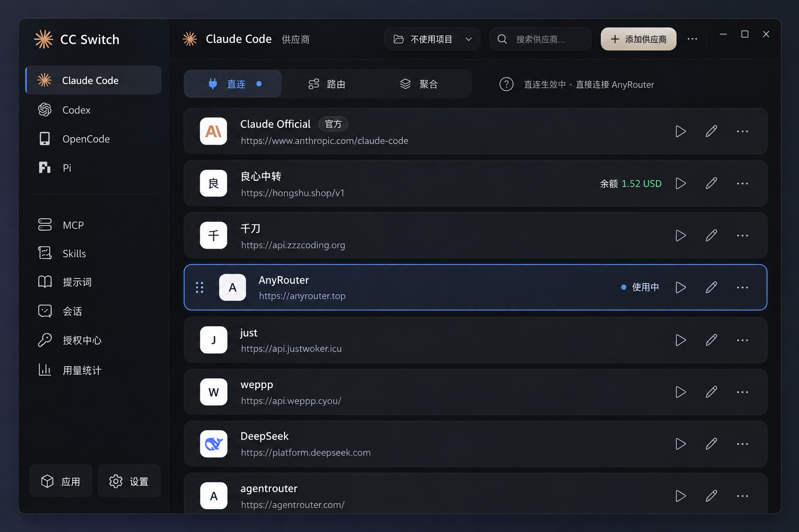
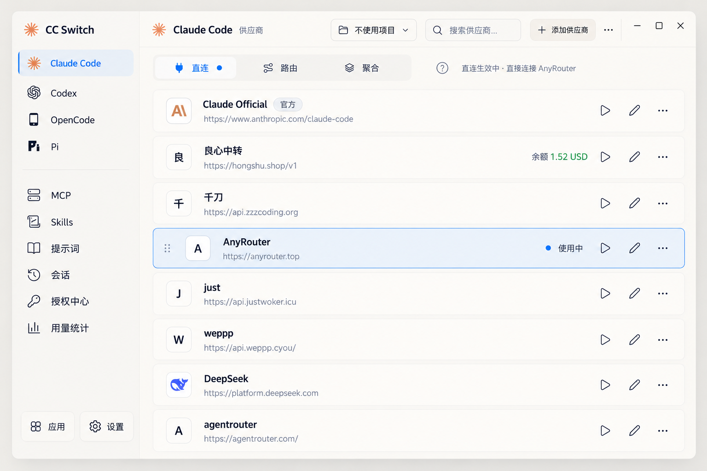

# BetterCCS 前端 UI 改造需求

文字描述不对视觉层面照顾不全，推荐查看整改效果图：

## 一、项目目标

基于 [CC Switch](https://github.com/farion1231/cc-switch) 进行轻量化 Fork，项目暂定名为 **BetterCCS**。

此次改造的目标不是重新设计产品交互，而是在保留 CC Switch 原有易用性和配置管理逻辑的前提下，优化视觉体验。

设计参考：

- 原版 CC Switch：保留其清晰直观的信息架构和操作流程。
- Magpie：参考其克制的界面风格、低视觉噪声和舒适的信息层级。
- X.com：参考黑白主色调、简洁按钮、清晰字体与克制的界面表达。
- 附件中的深色和浅色效果图：作为主要视觉目标，但不要求逐像素复刻。

**最重要的原则：做减法，不做多余的设计。**

## 二、全局布局优化（最高优先级）

### 1. 减少全局分割线

这是原版 CC Switch 最需要改善的问题。

重点修改：

- 去掉左侧边栏内部大部分横向分割线。
- 去掉或极度弱化左侧栏与主内容区之间的竖线。
- 去掉或极度弱化顶栏底部的横线。
- 避免使用高对比度描边将整个窗口切割成多个矩形区域。

新的布局应主要依靠以下方式表达结构：

- 轻微的背景明暗差异。
- 合理的留白和间距。
- 文字与图标的信息层级。
- 必要时使用极浅的阴影或低对比度边界。

**目标：让各功能区域自然融为一个完整的桌面工作空间，而不是看起来像由多个网页组件拼接而成的管理后台。**

### 2. 优化左侧边栏

保留现有导航逻辑及大致宽度，不重新设计导航结构。

调整：

- 减少不必要的分割线。
- 使用留白区分不同功能组。
- 选中菜单使用柔和背景色，不使用醒目的边框。
- 统一图标大小、文字层级和菜单项间距。
- 底部设置入口保持清晰，但避免使用过重的按钮容器。

导航区域应有秩序感，但视觉存在感不能压过主要内容。

### 3. 大幅弱化顶栏

原版顶栏视觉重量偏大，内容排列过于拥挤。

改造要求：

- 将顶栏高度适当压缩，建议以 40–46px 左右作为初步设计参考，根据实际窗口适配调整。
- 缩小顶栏按钮的高度、内边距和视觉体积。
- 减少顶栏背景与主内容背景之间的强烈分割。
- 适当弱化次级功能图标。
- 尽可能减少顶栏元素之间的明显边框。
- 保留原有项目选择、搜索、添加供应商、窗口控制等功能。

**“添加供应商”按钮必须去掉原本高饱和度的橙色背景。**

建议使用黑白对比或柔和暖灰作为主按钮颜色，确保可识别、可点击，但不再成为整个界面最抢眼的元素。

## 三、整体视觉与主题系统

### 深色模式

参考 X.com 的黑色主题，但避免完全纯黑造成的生硬感。

建议：

- 主背景：接近黑色的中性深灰。
- 侧边栏：与主背景存在非常轻微的明暗差异。
- 次级表面：深炭灰。
- 主文字：柔和白色。
- 次级文字：中性灰。
- 边框：极低对比度，仅在必要时使用。

追求沉稳、干净、统一，不要过多渐变、发光和装饰性阴影。

### 浅色模式

不要使用刺眼的纯白。

采用带有轻微米黄色倾向的暖白色体系：

- 主背景：暖白或极浅米灰，例如 #F7F5F0。
- 次级背景：浅米灰，例如 #EFEBE5。
- 主文字：接近黑色的深灰。
- 次级文字：柔和的中灰。
- 分割与边界：尽量依靠表面色差，而不是明显描边。

整体风格应温和、干净，避免传统管理后台常见的冷白色与大量蓝灰边框。

以上颜色仅为参考，可以统一微调。

### 强调色

全局以黑、白、灰、米白为主。

- 不再以橙色作为大面积操作强调色。
- 品牌 Logo 可以保留原始色彩，但应控制视觉影响。
- 选中项优先通过背景变化表现。
- 成功、警告、余额等语义信息可以保留少量功能性颜色。
- 避免多种高饱和度颜色同时争夺注意力。

## 四、供应商列表优化

保留 CC Switch 原有的供应商列表交互方式，不要重新设计配置切换流程。

保留：

- 供应商名称与图标。
- API 地址。
- 当前使用状态。
- 一键切换。
- 编辑和更多操作。
- 必要的余额信息。

视觉优化：

1. 降低普通供应商卡片的边框存在感。
2. 使用柔和背景色区分列表项。
3. 适当弱化 URL 等次级文字。
4. 统一操作图标的视觉重量。
5. 当前使用的供应商应清楚可辨，但避免高亮粗边框。
6. 不要为了追求高级感而盲目增大卡片高度和间距。

**重要：保持较高的信息效率和列表可扫描性。**

CC Switch 原有的快速浏览、切换配置体验是优势，不能因为美化而降低操作效率。

## 五、功能精简

BetterCCS 定位为专注于 AI CLI 配置管理的轻量工具。

主要保留：

- 多种 AI CLI 工具的配置管理。
- 供应商添加、删除、编辑。
- 配置文件管理。
- 供应商一键切换。
- 必要的配置导入、导出与备份能力。

计划移除：

- 路由模式。
- 聚合模式。
- 协议转换。
- 多供应商聚合以及相关的复杂代理功能。

前端设计上，不再需要「直连 / 路由 / 聚合」三个模式切换标签。供应商列表可以直接成为主内容。

**注意：第一阶段只处理 UI 入口和相关状态，不要在未分析依赖的情况下直接删除后端代码。**

其他功能（MCP、Skills、提示词、会话等）暂时不作为本次改造重点。

## 六、工程实施要求

1. 首先分析 CC Switch 当前实际的前端技术栈、组件结构、样式组织和主题实现。
2. 优先复用现有组件与设计变量，避免完全重写。
3. 建立统一的主题变量，包括背景、文字、边框、圆角、间距和交互状态。
4. 优先修改全局 Layout、Sidebar、Header 和主题系统，再调整供应商列表。
5. 同步支持深色与浅色模式，不能只优化其中一种。
6. 保持窗口缩放、滚动、悬停、焦点、选中状态等行为正常。
7. 确保配置读取、写入、一键切换等现有核心功能不受影响。
8. 不额外引入不必要的大型 UI 框架或视觉效果库。

## 七、验收标准

完成后，界面应当：

- 第一眼明显比原版更加简洁、安静。
- 左侧栏不再被多条明显分割线切割。
- 顶栏更薄、更轻，不再有工具条压迫感。
- 添加供应商按钮融入整体黑白配色。
- 深色模式接近黑灰色系，浅色模式是柔和暖白色系。
- 内容区域依靠背景层级与留白组织，而不是密集描边。
- 原有供应商列表仍然容易浏览和操作。
- 没有为了美观牺牲信息密度和交互效率。

**最终目标：让 BetterCCS 看起来像一款经过认真打磨的现代桌面应用，而不是 Web 管理后台。**

## 八、执行方式

请先阅读并分析仓库源码，找到与以下部分相关的实际文件：

- 全局布局
- 左侧导航栏
- 顶栏与窗口标题栏
- 深浅色主题
- 供应商列表
- 路由与聚合模式入口

先给出文件级别的改造计划，说明哪些组件需要调整、哪些样式可以复用、哪些功能依赖需要注意。

随后按照以下顺序逐步实施：

**全局视觉骨架 → 主题配色 → 顶栏和侧栏 → 供应商列表 → UI 功能精简 → 测试。**

每阶段尽量控制修改范围，确保项目能够正常构建和运行。

请特别注意：**不要擅自重构整个项目、替换技术栈或改变已有核心交互。**
